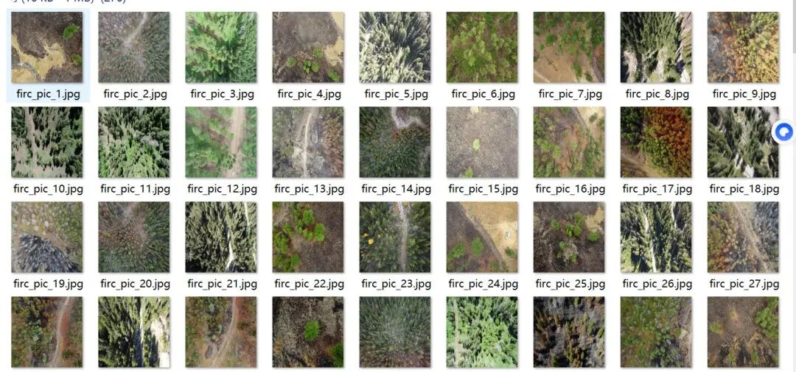
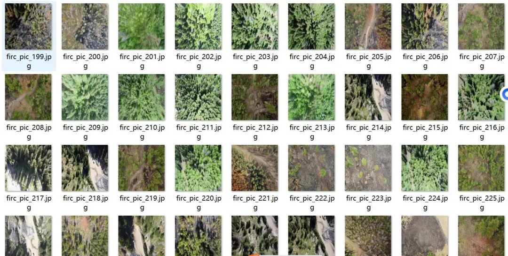
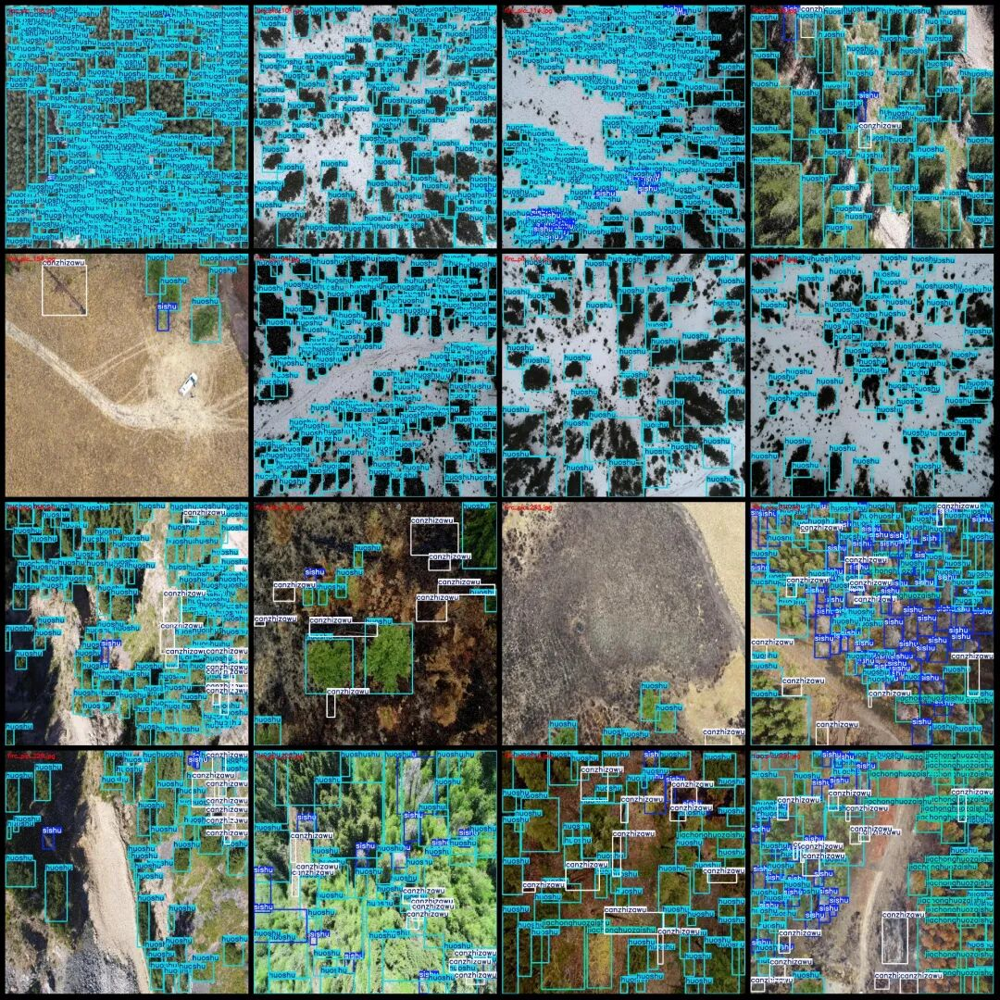
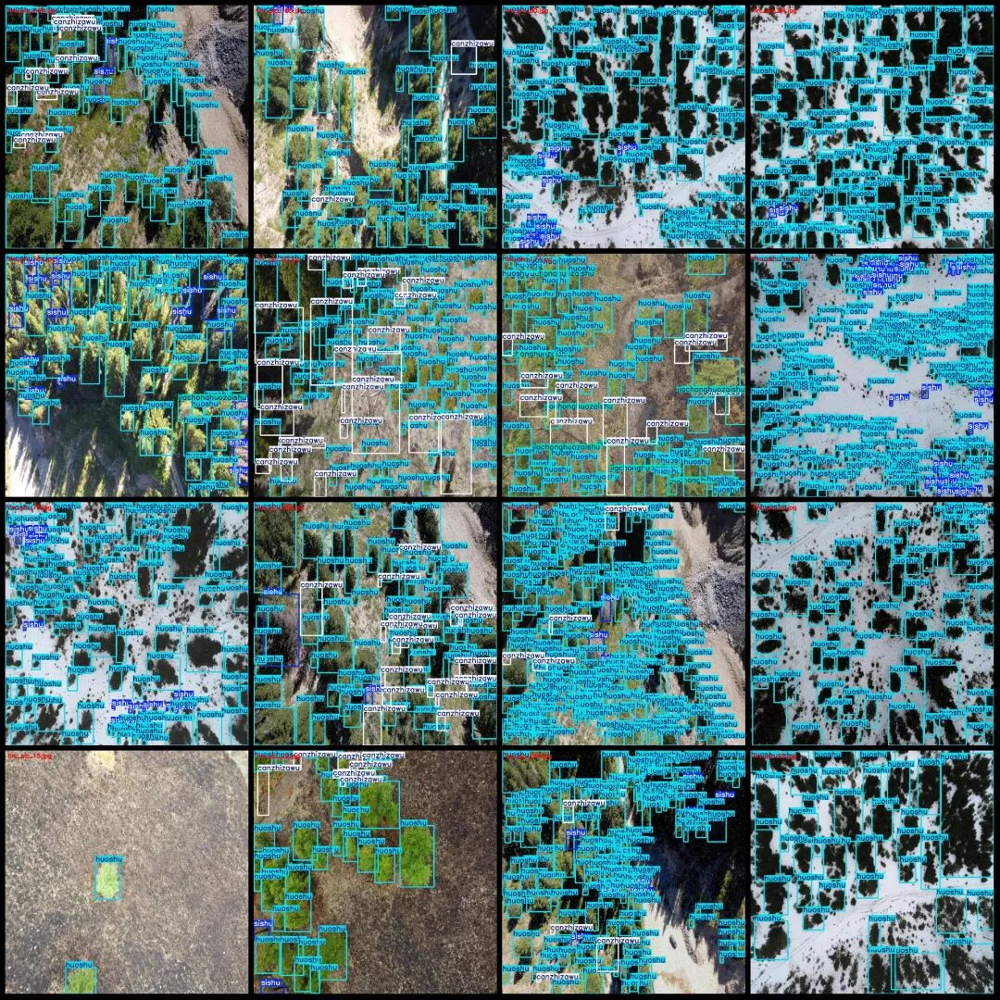

# UAV Perspective Aerial Photos Forest Tree Health Status Detection Dataset VOC+YOLO format with 276 images in 4 categories

Dataset format: Pascal VOC format + YOLO format (txt file without split path, only contains jpg images and corresponding VOC format xml files and yolo format txt files)

Number of images (number of jpg files): 276

Number of annotations (number of xml files): 276

Number of annotations (number of txt files): 276

Label category count: 4

Label category names (Note that the order of categories in the YOLO format does not correspond to this, but is based on the labels folder's classes.txt): ["canzhizawu", "huoshu", "jiachonghuozaishu", "sishu"]

Matched Chinese category name: ["Remnants and debris", "Live Tree", "Fire-breathing tree of dead wood", "Dead Tree"]

Number of boxes labeled in each category:

Canzhizawu Frames = 2427

Huoshu Frame Count = 27346

jiachonghuozaishu Frames = 2336

Sishu frame count = 3466

Total frame count: 35575

Number of images per category:

Canzhizawu's possession of images = 188

Huoshu's number of owned images = 276

jiachonghuozaishu Number of photos held = 96

Sishu's total number of images = 211

Image resolution: 1024x1024

Using labelImg:

Annotation rules: Draw a rectangle around the category.

Important Notice: The dataset does not have separate training, validation, and test sets; you need to partition them yourself.

Special : This dataset does not guarantee the accuracy of the trained models or weight files.

Image Preview:

Annotation example:

## Payment

Here is a pay link on Stripe ( https://buy.stripe.com/3cs8yP7sY87d0vu9AB ). Please contact me lonlonago@foxmail.com after funding $89, and I will send you a complete data files , thank you!

